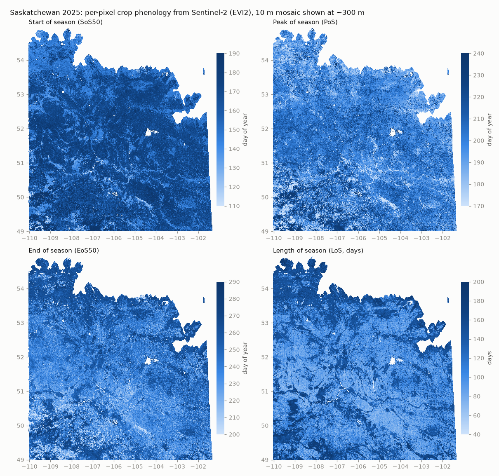

# crop-phenology

Seamless 10 m crop phenology for the Canadian Prairie cropland ROI (SK, MB, BC Peace, AB) from local
Sentinel-2 L2A Zarr stores. Phenology is fitted **per pixel** from all observations of the year (no
composites, no fixed calendar windows), so tile edges, orbit swaths and provincial borders do not show up in
the maps. Runs on the Fir cluster (DRAC, SLURM).

## Pipeline

| step | script | job | output |
|---|---|---|---|
| 0 census | `00_census.py` | `jobs/00_census.sbatch` | STAC item list of MPC `sentinel-2-l2a` over the ROI: `outputs/inventory/census_<ACTIVE>/items_<year>.csv.gz` |
| 1 inventory | `01_inventory.py` | `jobs/01_inventory.sbatch` | stores × tiles × dates audit: `outputs/inventory/{store_tiles,jobs,tile_index}.csv`, dates to re-download `fill_<year>.csv` |
| 1b fill | `01b_fill.py` | `jobs/01b_fill.sbatch` | re-downloaded missing/wrong dates: `$SCRATCH/crop_phenology_zarr/fill/s2_<year>/<tile>.zarr` |
| 2 phenology | `02_phenology.py` | `jobs/02_phenology.sbatch` | one int16 GeoTIFF per 25 km tile-year: `$SCRATCH/crop_phenology_zarr/tiles/<tile>/<year>/pheno_<tile>_<year>.tif` |
| 3 mosaic | `03_mosaic.py` | `jobs/03_mosaic.sbatch` | province mosaic per band: `$SCRATCH/crop_phenology_zarr/mosaic/<province>/<year>/pheno_<band>_<year>.tif` + VRTs |

Code:

| file | content |
|---|---|
| `config.py` | all paths and parameters (importable without third-party packages) |
| `cpz/grid.py` | MGRS 25 km tile grid (10 m UTM), ROI, DEM-aligned EPSG:4326 mosaic grid |
| `cpz/store.py` | reads a tile's time series from the S2 stores, merges the fill store (fill date wins on a duplicate DOY), fixes the +1000 DN baseline offset |
| `cpz/lsp.py` | per-pixel land-surface phenology (screening, Whittaker fit, season metrics, QA bits) |
| `cpz/qc.py` | boundary/overlap accumulators used by step 3 |

## Running a province

From the repository root, with `CPZ_ACTIVE` listing the province and its neighbours that already have stores
(`sbatch` passes the environment):

    export CPZ_ACTIVE=SK,MB CPZ_PROVINCE=SK
    c=$(sbatch --parsable jobs/00_census.sbatch)
    i=$(sbatch --parsable --dependency=afterok:$c jobs/01_inventory.sbatch)
    f=$(sbatch --parsable --array=0-9%3 --dependency=afterok:$i jobs/01b_fill.sbatch --year 2025)
    i2=$(sbatch --parsable --dependency=afterany:$f jobs/01_inventory.sbatch)     # picks up the fill stores
    p=$(sbatch --parsable --array=0-4 --dependency=afterok:$i2 jobs/02_phenology.sbatch --year 2025)
    sbatch --dependency=afterok:$p jobs/03_mosaic.sbatch --year 2025

- `CPZ_ACTIVE` (default `SK,MB`): provinces whose stores the inventory covers. Tiles are province-free: a
  tile held by two provinces' stores is computed once, from one date set, into one shared tile file.
- `CPZ_PROVINCE` (default `SK`): step 2 computes the tiles touching that province's ROI extended by 2 km
  (`EDGE_BUFFER_KM`); step 3 mosaics that buffered ROI. All provinces share one EPSG:4326 lattice and one
  parameter set, so adjacent province mosaics hold identical pixels in their overlap.
- Step 2 skips tiles whose `params_hash` (parameters) and `input_hash` (store, dates) are unchanged; step 3
  refuses tiles with mixed `params_hash`.
- Login-node check of step 2 on one 512 × 512 block:
  `python -u 02_phenology.py --year 2019 --debug-block 12UWE7525 1024 1024 --out <dir>`.

Environments (set in the job scripts):

- steps 0, 1, 2, 3: Python 3.11 virtualenv `$HOME/envs/cropclassify` (`module load StdEnv/2023 python/3.11`)
  with numpy, pandas, zarr ≥ 3, numba, rasterio, pyproj, shapely, pyshp, mgrs, affine, scipy, matplotlib,
  pystac-client;
- step 1b: the gaig-stac downloader venv (`config.GAIG_PY`, override with `CPZ_GAIG_PY`); needs internet
  (Planetary Computer STAC and blob storage).

## Input data

Sentinel-2 L2A Zarr stores (gaig-stac), one per province-year: `bands` `(tile, t, 3660, 3660, 10)` uint16 in
the order B04 B02 B03 B08 B8A B05 B06 B07 B11 B12, `masks` `(tile, t, y, x)` 1 = SCL-valid, `doys` `(tile, t)`
with 0 = empty slot, tile order in `attrs['mgrs_tiles']`. Data fill the top-left 2500 × 2500 px (25 km at
10 m). Further inputs: the cropland ROI shapefile and the DEM that sets the EPSG:4326 mosaic lattice. All
input locations are set in `config.py`; inputs are read-only and no step writes into them.

Working files (tiles, fill stores, mosaics) go to `$SCRATCH/crop_phenology_zarr` (`CPZ_WORK` overrides),
which is **not backed up and purged after 60 days**: copy finished mosaics to `/project`.

## Tile grids

`tile_grids/` holds the MGRS 25 km sub-tile grids the stores are built on (EPSG:4326 polygons, attribute
`MGRS`; each tile is a 25 km square in its own UTM zone at 10 m, see `cpz.grid.tile_grid`):

| file | content |
|---|---|
| `saskatchewan_mgrs_tiles_25km_corrected.geojson` | SK tiles |
| `canadian_prairie_mgrs_tiles_25km_corrected.geojson` | AB, SK, MB and BC Peace tiles |
| `tile_index.csv` | stable integer id per tile (`idx, tile`) used as the source id of the mosaics; step 1 writes the working copy to `outputs/inventory/tile_index.csv` |

## Method (`cpz/lsp.py`)

Per pixel, from all of its observations of the year:

- **Screening** (reflectance = DN · 1e-4): valid = SCL mask & B08 > 0 & B04 > 0; **snow** = NDSI > 0.4 &
  B03 > 0.10 (dropped from the fit, kept for the snow bit); EVI2 outside −0.2..1 dropped; **haze** B02 > 0.12
  → initial weight 0.3.
- **Floor**: 10th percentile of an upper-envelope Whittaker pre-fit. Observations more than 0.05 below the
  floor (residual cloud / shadow) and positive spikes (> 0.15 above every observation within 20 d on both
  sides) are dropped; the rest are raised to the floor.
- **Dormant points**: pseudo-observations (weight 0.5) every 10 d from 20 d before the first and 20 d after
  the last observation.
- **Fit**: weighted Whittaker smoother on a daily grid with a density-scaled λ = 300 · clip(n_obs / 54,
  0.5, 2), 2 upper-envelope passes.
- **Season**: PoS = peak in DOY 60–330; left / right bases = curve minimum before / after the peak; no
  season when either side rises less than 0.08. SoS / SoS50 = last day before PoS where the curve crosses
  base_L + 0.2 / 0.5 · amplitude; EoS50 / EoS likewise after PoS with base_R. A crossing not found in DOY
  60–330 is NaN with a QA bit (never clamped). LoS = EoS − SoS; AUC = integral of max(curve − base, 0)
  over SoS..EoS.

Output bands (`config.OUT_BANDS`, int16, nodata −32768; physical = stored × scale, AUC 0.01, amplitude and
base 1e-4, others 1): `SoS SoS50 PoS EoS50 EoS LoS AUC amplitude base n_obs max_gap gap_sos gap_eos qa`.

QA bits (`config.QA_BITS`):

| bit | name | meaning |
|---|---|---|
| 1 | low_amplitude | no season (peak − base < 0.08 on either side) |
| 2 | few_obs | fewer than 8 kept observations in DOY 60–330 |
| 4 / 8 | gap_at_sos / gap_at_eos | observation gap > 30 d on the green-up / senescence ramp |
| 16 / 32 | sos / eos_outside_search | crossing not found inside DOY 60–330 |
| 64 / 128 | date_gap_sos / date_gap_eos | acquisition-date gap > 20 d on the ramp (input defect) |
| 256 | snow_at_sos | snow observation before PoS within 15 d of SoS |
| 512 | green_at_start | first in-season observation already above half amplitude (winter cereal, perennial) |
| 1024 | overshoot | peak > highest observation + 0.05 |

Clean pixels: SoS / SoS50 where `(qa & 1879) == 0`, EoS / EoS50 where `(qa & 1195) == 0`.

## Known input limits

- SK: 16 tile ids in the 2019–2025 main stores hold the wrong land (`config.MISLABELLED`, skipped; covered
  by the triangle / priority stores).
- Some tile-years in the stores miss acquisition dates; step 1 lists them and step 1b re-downloads them.
  Pixels with gappy data carry gap bits (4 / 8 per pixel, 64 / 128 for missing acquisitions).
- AB has 2019–2023 only so far, and its tile grid leaves ~4,550 km² of the AB ROI uncovered; the BC ROI
  strip at −120.24..−120° is covered only by AB tiles.
